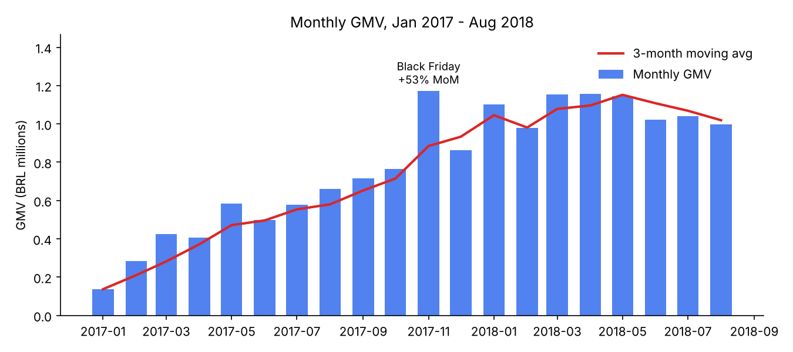
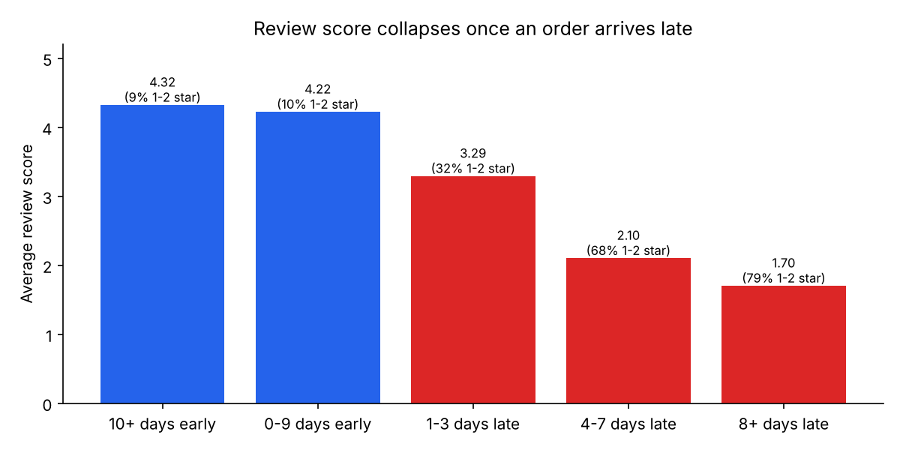
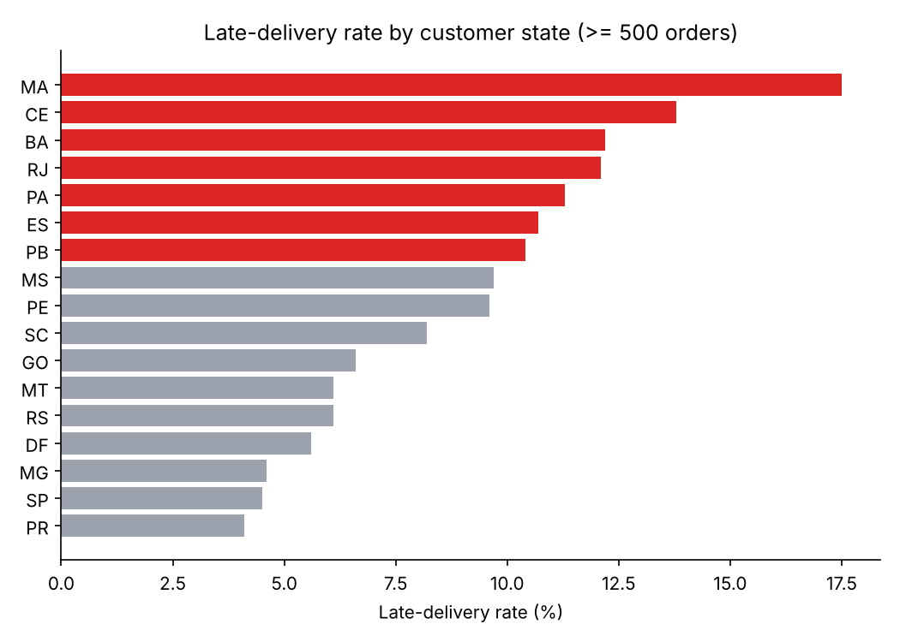
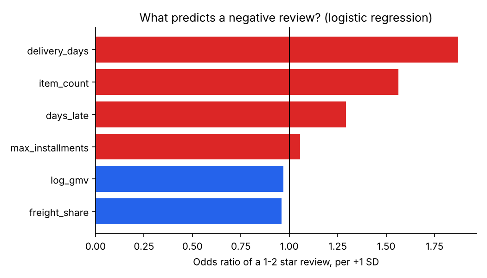
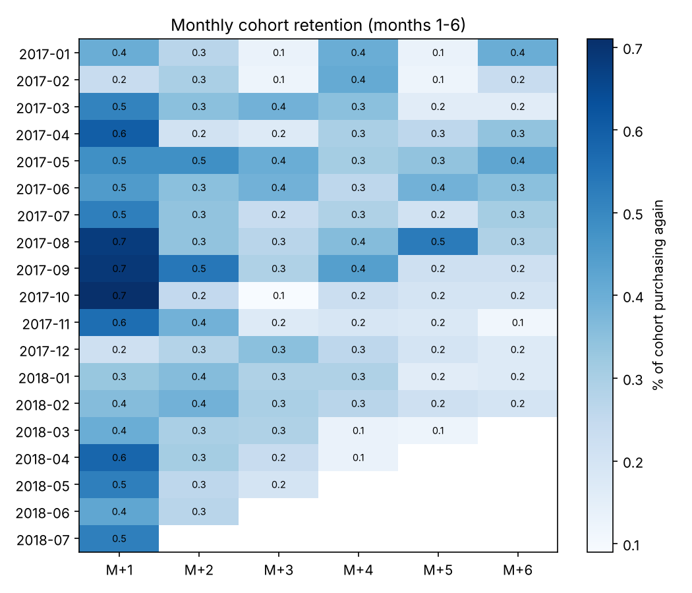
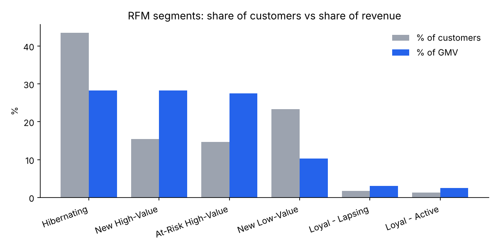

# E-commerce Sales & Customer Analytics (SQL · Python · Power BI)

[](https://github.com/leoyaoguanyu/ecommerce-sales-analytics/actions)

End-to-end analysis of **~100K orders** from Olist, a Brazilian e-commerce
marketplace: PostgreSQL data model and cleaning, SQL business analyses
(CTEs, window functions, cohorts, RFM), statistical testing in Python, and
a Power BI dashboard for stakeholders.

**Business questions:** How is revenue growing? Which categories and
sellers drive it? Does late delivery hurt customer satisfaction, and where?
Do customers come back, and which ones are worth retaining?

## Key findings

Scope: 97,905 valid orders · 94,703 customers · R$15.68M GMV ·
Jan 2017 – Aug 2018.

| # | Finding | Evidence |
|---|---|---|
| 1 | **Late delivery is the #1 driver of bad reviews.** Late orders average **2.27★ vs 4.29★** on time; their 1–2★ rate is **6.8× higher** (62.4% vs 9.2%). Orders 8+ days late: 1.70★, 79% negative. | Mann-Whitney U and χ² tests, p < 0.001 (`outputs/stats_summary.csv`) |
| 2 | Delivery time is the strongest predictor of a 1–2★ review (odds ×1.87 per SD), followed by number of items (×1.56: multi-item orders, likely split shipments). | Logistic regression, hold-out ROC-AUC 0.73 |
| 3 | **Lateness is regional.** Maranhão (17.5%), Ceará (13.8%), Bahia (12.2%) and Rio de Janeiro (12.1%, 12K orders) vs São Paulo 4.5%. | `04_delivery_by_state.sql` |
| 4 | **Customers almost never come back:** 3.0% repeat rate, ~0.5% of a cohort buys again the next month; repeat buyers bring only 5.7% of GMV. | `05`, `06_cohort_retention.sql` |
| 5 | **14.7% of customers are "At-Risk High-Value"** (big spenders, inactive 13 months on avg) holding 27.5% of GMV — the best win-back target. | `07_rfm_segmentation.sql` |
| 6 | Revenue is concentrated: the **top 10% of sellers generate 66.5% of GMV**; the bottom 50% only 3.5%. | `08_seller_concentration.sql` |
| 7 | GMV grew ~8× from Jan 2017 to a ~R$1.0–1.16M/month plateau in 2018; Black Friday 2017 spiked **+53% MoM**. Credit-card orders in 7+ instalments have **3.3× the AOV** of single payments (R$335 vs R$101). | `01`, `09` |

### Recommendations

1. **Fix delivery in the Northeast and Rio de Janeiro first** — RJ alone has
   ~1,500 late orders. Review carriers / add regional fulfilment there.
2. **Proactively contact customers when an order slips** (status update +
   small voucher): the satisfaction drop starts at just 1–3 days late (3.29★).
3. **Launch a win-back campaign for At-Risk High-Value customers** and a
   second-purchase incentive for new buyers, since repeat rate is near zero.
4. **Key-account management for the top 10% of sellers**, who carry two
   thirds of revenue.




<details>
<summary>More charts</summary>





</details>

## Power BI dashboard

Three pages — Executive Overview, Delivery & Satisfaction, Customers &
Payments — built on a star schema exported from PostgreSQL
(`powerbi/data/`), with DAX measures for KPIs, MoM growth, 3-month moving
average and repeat rate (`powerbi/measures.dax`). Build steps:
[`powerbi/BUILD_GUIDE.md`](powerbi/BUILD_GUIDE.md).

<!-- Screenshots: reports/figures/dashboard_*.png -->

## How it works

```
data/raw/*.csv (Kaggle)
   │  sql/01_schema.sql, 02_load.sql      typed raw tables, PK/FK constraints
   ▼
raw.*  ──  sql/03_clean.sql               star schema: fct_orders, fct_order_items,
   │                                       dim_customer / product / seller
   ▼
analytics.*  ──  sql/04_data_quality.sql  10 checks; blocking failures stop the pipeline
   │
   ├── sql/analysis/01-09_*.sql  ──►  outputs/*.csv     (business answers)
   ├── src/analysis.py           ──►  stats_summary.csv + reports/figures/
   └── sql/05_powerbi_export.sql ──►  powerbi/data/*.csv ──► Power BI
```

**Data model & cleaning decisions** (all in `sql/03_clean.sql`):
- Revenue (GMV) = item price + freight, excluding `canceled` / `unavailable` orders.
- Window limited to complete months 2017-01 … 2018-08 (2016 and Sep–Oct 2018 have < 350 orders).
- A customer is `customer_unique_id` — Olist issues a new `customer_id` per order,
  so counting `customer_id` would hide every repeat purchase.
- 551 duplicate reviews removed (latest answer kept per order); 610 products without
  a category labelled `unknown`; categories translated to English.

**SQL techniques used:** CTEs, window functions (`LAG`, moving `AVG`,
`RANK`, `NTILE`, `PERCENT_RANK`, running `SUM` for Pareto), `DISTINCT ON`
dedup, cohort analysis with `AGE()`, conditional aggregation.

**Testing:** 11 pytest tests — unit tests for the statistics code, plus
reconciliation tests asserting that every analysis output and the Power BI
export add up to the same GMV / order / customer totals (catches join
fan-out and filter drift). Run in GitHub Actions CI.

## Reproduce

```bash
# 1. Data: download "Brazilian E-Commerce Public Dataset by Olist" from Kaggle,
#    unzip the CSVs into data/raw/
# 2. PostgreSQL (any recent version)
createdb olist
export PGDATABASE=olist        # plus PGHOST / PGUSER / PGPASSWORD if needed
./run_pipeline.sh              # load -> clean -> DQ gate -> analyses -> exports (~15 s)

# 3. Statistics + charts
pip install -r requirements.txt
python -m src.analysis
python -m pytest -q
```

## Limitations

- Observational data: lateness is strongly *associated* with low reviews, but
  other factors (product quality, seller) also play a role; the regression
  controls only for the order-level features listed.
- Public, anonymised 2016–2018 sample of one marketplace; GMV is item price +
  freight and may differ slightly from payment totals (249 orders differ by > R$1).

## Project structure

```
sql/                 schema, load, cleaning, data-quality, Power BI export
sql/analysis/        9 business-question queries
src/analysis.py      hypothesis tests, logistic regression, charts
outputs/             query results (CSV) + stats_summary.csv
powerbi/             star-schema CSVs, measures.dax, BUILD_GUIDE.md
reports/figures/     charts
tests/               unit + reconciliation tests
run_pipeline.sh      one-command pipeline
```

Data: [Olist, Brazilian E-Commerce Public Dataset (Kaggle, CC BY-NC-SA 4.0)](https://www.kaggle.com/datasets/olistbr/brazilian-ecommerce).
